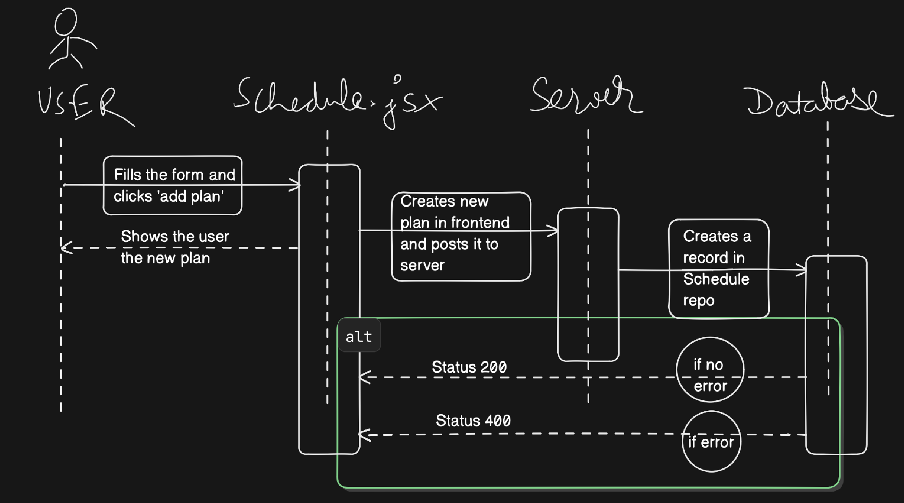

# Workout Tracker

[](https://github.com/Jiwesh-Kashyap/Workout-Tracker/actions/workflows/ci.yml)

This is the workout tracker project created by me using MERN stack.

Website link - https://workout-tracker-5ym.pages.dev/  
Roadmap.sh link - https://roadmap.sh/projects/fitness-workout-tracker


Many people going to the gym or doing calisthenics don't even note their current status. They just keep on doing the same things they did the previous week and the week before it.
To solve this, people need to track their workouts by noting or saving them down.
Workout Tracker does the exact thing. You can add your routine with daily plans in here to know what to do next. You can now do Progressive Overload efficiently and cleanly.

## Tech Stack used:
* Frontend - React, Tailwind CSS, Recharts, SortableJS
* Backend - Node.js, Express, MongoDB, Mongoose, JWT & Bcrypt
* Testing - Vitest, React Testing Library, Supertest (78 automated tests)
* DevOps & CI/CD - Docker, Docker Compose, Nginx, GitHub Actions

---

## Setup Process

### Option 1: Running with Docker (Recommended)

You can run the entire full-stack application (frontend, backend, and MongoDB) with a single command without needing Node or MongoDB installed locally:

```bash
docker compose up --build
```

- Frontend runs on `http://localhost:5173`
- Backend runs on `http://localhost:4000`
- MongoDB runs on port `27018` with persistent storage via Docker volume `mongo-data`

To stop the containers:
```bash
docker compose down
```

---

### Option 2: Manual Local Setup (Without Docker)

#### Prerequisites
- Node.js installed on your machine
- MongoDB running locally or a MongoDB Atlas URI

#### 1. Install Dependencies
```bash
# Install frontend dependencies (root directory)
npm install

# Install backend dependencies
cd backend
npm install
cd ..
```

#### 2. Configure Environment Variables

**Backend Variables**  
Create a `.env.development` file inside the `backend/` directory:
```env
PORT=4000
MONGO_URI=mongodb://127.0.0.1:27017/workout-tracker
NODE_ENV='development'
```
*(Change the `MONGO_URI` if you are using a different local or cloud database).*

**Frontend Variables**  
Create a `.env.development` file in the root directory:
```env
VITE_API_BASE_URL=http://localhost:4000
```

#### 3. Run the Application
From the root directory, start both the frontend and backend servers concurrently:
```bash
npm run dev
```
The frontend will run on `http://localhost:5173` and the backend will run on `http://localhost:4000`.

---

## Running Automated Tests

The project includes unit and integration tests across both frontend and backend. Continuous Integration runs automatically via GitHub Actions on every push and pull request.

To run tests locally:

```bash
# Run Frontend tests (50 tests with Vitest & React Testing Library)
npx vitest run src

# Run Backend tests (28 tests with Vitest & Supertest)
cd backend && npx vitest run
```

---

## Screenshots of the website


## Architecture

A sample Sequence Diagram to 'Add a plan'

